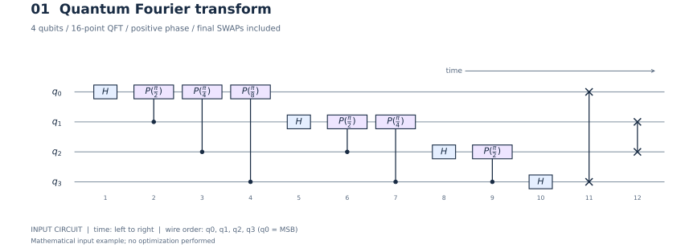
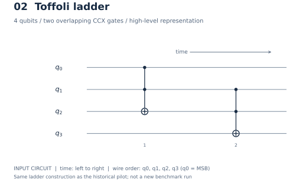
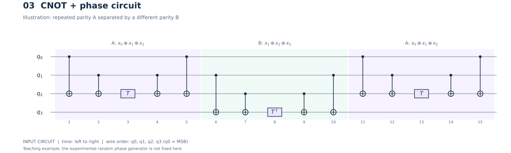
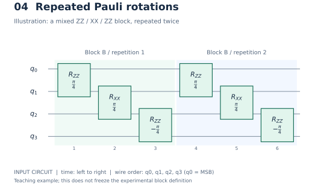
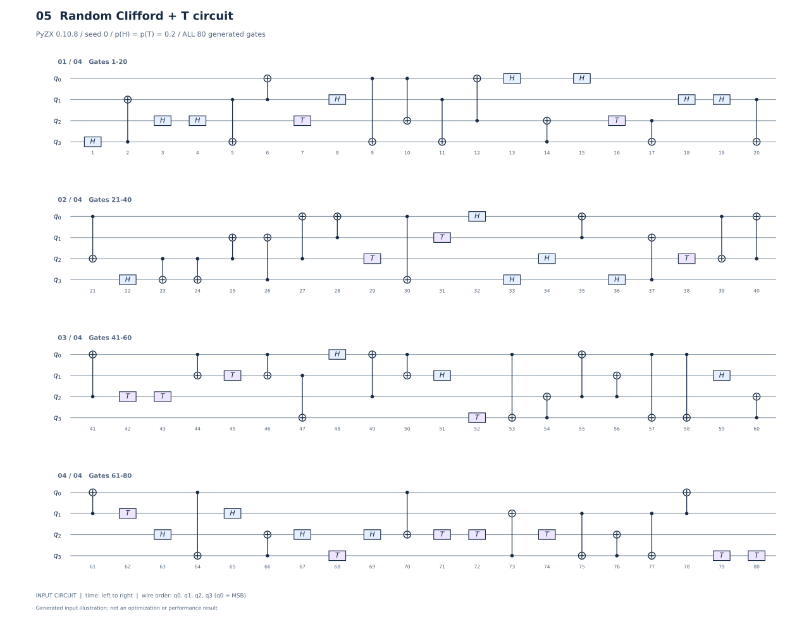

# 比較する5種類の回路図

**作成日：2026-11-18（Asia/Tokyo）**  
**対象：[現行研究計画](research_plan.md)の入力回路ファミリー**

各ファミリーの構造を4量子ビットの回路図で示す。これらは入力の説明図であり、最適化の実測結果ではない。位相回路と反復Pauli回転の例は、構造を説明するための具体例であり、本実験の生成規則を確定するものではない。

| ファミリー | このページの例 | 図の位置づけ |
| --- | --- | --- |
| [QFT](#qft) | 4量子ビット・16点、末尾SWAPあり | 定義を明示した標準構成 |
| [Toffoli ladder](#toffoli-ladder) | 重なり合う2個のToffoli | 既存パイロットの生成規則に対応 |
| [位相回路](#phase-circuit) | パリティ位相ブロックA・B・A | 重複を含ませた説明用の例 |
| [反復Pauli回転](#repeated-pauli) | 異なる3回転のブロックを2回 | 可換性と反復構造の説明用の例 |
| [ランダムClifford＋T](#random-clifford-t) | 4量子ビット・80ゲート・seed 0 | 計画中の生成条件から得た入力例 |

## 図の読み方と評価の区別

- **時間は左から右**へ進む。複数パネルでは上のパネルから順に続けて適用する。
- 上から`q0, q1, q2, q3`。このページの行列・状態表記は $|q_0q_1q_2q_3\rangle$ とし、**q0を最上位ビット**とする。
- 入力ワイヤは任意の量子状態を表す。全量子ビットを $|0\rangle$ に初期化した状態準備回路ではない。
- 黒丸は制御、丸付きの＋はX標的、×同士を結ぶ記号はSWAP。複数ワイヤを覆うPauli回転の箱は、一つの共同演算を表す。
- 下の数字はゲート列の通し番号であり、計測する回路depthではない。同時実行できるゲートを同じ列にまとめる配置は行っていない。
- HはHadamard、$P(\theta)=\operatorname{diag}(1,e^{i\theta})$、$T=P(\pi/4)$、$T^\dagger=P(-\pi/4)$ とする。

図では読みやすさのためCP、SWAP、CCX、Pauli回転も使う。**評価用のT-count・2Qは、共通の基本ゲートへ分解してから数える。** 図上の箱や制御記号の個数を、そのままベンチマークの2Qとしない。QFTは一般角を含むため、現計画ではT-countをN/Aとして2Q・depthを主に比較する。

<a id="qft"></a>

## 1. QFT



*Figure 1. Four-qubit quantum Fourier transform with positive Fourier phases and explicit final swaps. The top wire is the most significant bit.*

4量子ビットは16個の計算基底状態を持ち、この回路は

$$
|j\rangle\longmapsto\frac14\sum_{k=0}^{15}e^{2\pi i jk/16}|k\rangle
$$

を実現する。図の制御位相は $CP(\theta)=\operatorname{diag}(1,1,1,e^{i\theta})$。制御付き $R_z(\theta)$ とは異なる。末尾の2個のSWAPも回路に含め、出力順を定義とそろえている。

規則的に配置された制御位相をZX処理で整理できるか、再抽出によるコストが利益を上回るかを調べる。定義は[IBMのQFT資料][qft]を参照。

<a id="toffoli-ladder"></a>

## 2. Toffoli ladder



*Figure 2. Four-qubit Toffoli ladder comprising two overlapping CCX gates. The second gate is controlled by the updated value on q2.*

最初に $CCX(q_0,q_1\!\rightarrow q_2)$、次に $CCX(q_1,q_2\!\rightarrow q_3)$ を適用する。Toffoliは二つの制御値がともに1のときだけ標的を反転する。2個目の制御には、1個目によって更新されたq2が使われる。

この構成は[既存パイロットの生成コード](../benchmarks/pilot-direction-only-8/pyzx_direction_pilot.py)の4量子ビット条件に対応する。基本ゲートへの分解後、T削減と2Q・depthの増減を併せて調べる。図はToffoliを高水準の記号で示しており、2個のCCXを「2Qが2個」と数えるものではない。

<a id="phase-circuit"></a>

## 3. 位相回路



*Figure 3. Illustrative CNOT–phase circuit with the chronological block sequence A, B, A. The repeated support of A demonstrates parity-phase redundancy.*

ブロックAは $x_0\oplus x_1\oplus x_2$ に角度 $\pi/4$、ブロックBは $x_1\oplus x_2\oplus x_3$ に角度 $-\pi/4$ の位相を付ける。それぞれ、CNOTでパリティを計算し、TまたはT†を適用して、CNOTで元のビット値に戻す。

作用対象を $S$ とすると、各ブロックの意味は

$$
\Phi_S(\theta)|x\rangle
=e^{i\theta(\bigoplus_{j\in S}x_j)}|x\rangle
$$

である。同じパリティへの位相が、別のブロックを挟んで再登場する構造を示している。[位相ガジェットと融合の説明][zxbook]も参照。

この例には説明のため重複を入れている。これを縮約できることだけでは、ZXがGate-onlyより有効という証拠にならない。本実験では回路長、位相比率、接続、乱数による生成規則を別途固定する。

<a id="repeated-pauli"></a>

## 4. 反復Pauli回転



*Figure 4. Two repetitions of an illustrative mixed-Pauli block. Each two-wire box denotes a joint Pauli rotation, not a pair of independent single-qubit rotations.*

Pauli回転を $R_P(\theta)=e^{-i\theta P/2}$ と定義する。この例の1ブロックは、時間順に

1. $R_{Z_0Z_1}(\pi/4)$。
2. $R_{X_1X_2}(\pi/4)$。
3. $R_{Z_2Z_3}(-\pi/4)$。

を適用し、全体で同じブロックを2回繰り返す。例えば $R_{ZZ}$ は2量子ビットの共同演算であり、$R_z\otimes R_z$ ではない。異なる軸の回転は一般には可換でなく、順番を自由に入れ替えられない。[Pauli回転の解説][zxbook]を参照。

ブロック境界を越えた位相・CNOT・基底変換の整理を調べるための例である。同じ単一回転を繰り返すだけなら $R_P(\theta)^r=R_P(r\theta)$ と単純に融合できるため、実験用にはブロックの作用対象、角度、順序を固定する必要がある。この説明図は最終的な実験ブロックの指定ではない。

<a id="random-clifford-t"></a>

## 5. ランダムClifford＋T



*Figure 5. A complete 80-gate random Clifford+T input generated with PyZX 0.10.8 and seed 0, shown in four consecutive panels of 20 gates.*

生成条件は次のとおり。

```python
pyzx.generate.CNOT_HAD_PHASE_circuit(
    qubits=4, depth=80,
    p_had=0.2, p_t=0.2,
    clifford=False, seed=0,
)
```

この関数の `depth=80` は**生成ゲート数80**を指定し、計測する回路の依存段数とは異なる。`p_had`と`p_t`は生成確率であり、HとTを必ず各16個配置する指定ではない。[PyZX API][pyzx]を参照。

全パネルは一つの回路の続きであり、パネル境界で状態を初期化しない。特定のアルゴリズムの規則性を設計していない入力で、改善量とシード間のばらつきを調べる。この入力の生成・作図は、Original／Gate-only／ZXの比較実験を実行したことを意味しない。

## 図のソースと再生成

- [回路定義と生成条件](circuits/circuit_examples.json)：時間順のゲート列、量子ビット、角度、例の位置づけ。
- [ランダム回路のOpenQASM](circuits/random_clifford_t_4q.qasm)：図5の全80ゲートを保存した入力。
- [描画スクリプト](../scripts/render_circuit_diagrams.py)：同じ定義から図を再生成する。
- [依存関係](../scripts/requirements-diagrams.txt)。
- [図の数値確認記録](circuits/diagram_checks.json)：説明図の演算内容を確認するための記録。最適化の性能結果・33入力の実験ログではない。

リポジトリのルートから実行する。

```bash
python -m pip install -r scripts/requirements-diagrams.txt
python scripts/render_circuit_diagrams.py
```

図中の英語ラベルとFigure captionは卒論の図の出発点として使える。実測結果を掲載するときは、実際に採用した入力・設定・run IDに対応する図を生成し、説明用の例と区別する。

[qft]: https://quantum.cloud.ibm.com/docs/en/api/qiskit/qiskit.circuit.library.QFTGate
[pyzx]: https://pyzx.readthedocs.io/en/latest/api.html
[zxbook]: https://zxcalc.github.io/book/html/main_htmlch7.html
