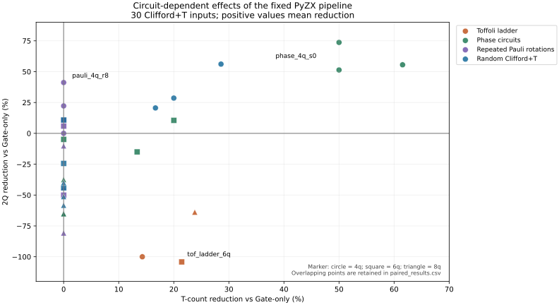
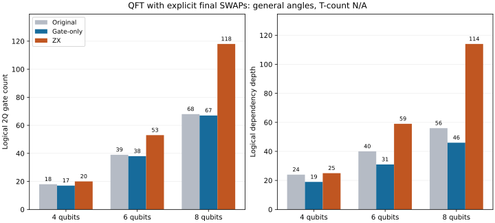

# Stage 1 実験結果 — 2026-11-24

4量子ビットの位相回路・ランダムClifford＋T回路、および4量子ビットで4回・8回反復するPauli回転回路において、T-countを増加させず2Qゲート数とdepthを改善できた。一方、QFTでは2Qとdepthが増加し、Toffoli ladderではT削減と2Q・depth増加のトレードオフが生じた。同一ファミリー内でも規模や反復数によって効果が変わることが観測された。

**33入力×3条件＝99行の測定を実行し、全99出力が数値的等価性検証に合格した。** Clifford＋Tの30入力では、Gate-onlyに対してT-countを増やさず2Qを減らした入力が12件あった。一方、8量子ビットの11入力はすべて2Qが増えた。回路ファミリーだけでなく、規模や構造によって結果が変わる。

- Run ID：`stage1-20261124T012423Z`。
- 実行日時：2026-11-24 **10:24:23–10:24:36 JST**。[実行メタデータ](../runs/stage1-20261124T012423Z/metadata.json)。
- 実行ソース：[5101804b3db69b5b0e09f872849a8acb1d2313c9](https://github.com/Ryoki39-hash/ZX-calculus/commit/5101804b3db69b5b0e09f872849a8acb1d2313c9)。Protocol：`stage1-standard-v1`。
- 環境：PyZX 0.10.8、Python 3.12.14、NumPy 2.3.5、Linux、AMD EPYC 9V74。BLAS関連スレッド数は1。
- 一次記録：[results.csv](../runs/stage1-20261124T012423Z/results.csv)、[timings.json](../runs/stage1-20261124T012423Z/timings.json)、[verification.json](../runs/stage1-20261124T012423Z/verification.json)。

## 1. 比較方法と集計

Original / Gate-only / ZXを同じ入力で比較した。ZXは`full_reduce`、元の向きの標準抽出（`optimize_cnots=2`）、共通のゲート整理を使用する。詳細は[固定した実験手順](../benchmarks/broad_screening/README.md)と[runの設定](../runs/stage1-20261124T012423Z/protocol.json)を参照。

以下の削減率は **100 × (Gate-only − ZX) / Gate-only**。正は削減、負は増加を表す。表は**入力ごとの削減率の中央値［最小, 最大］**であり、信頼区間ではない。各行のnは集計対象入力数で、計時10反復を入力数へ加えていない。

| Clifford＋T family | n | T削減率 % | 2Q削減率 % | depth削減率 % |
| --- | ---: | ---: | ---: | ---: |
| Toffoli ladder | 3 | 21.4 [14.3, 23.8] | −100.0 [−104.2, −63.9] | −61.5 [−66.7, −54.4] |
| Phase circuits | 9 | 13.3 [0.0, 61.5] | −4.9 [−65.2, 73.7] | 8.1 [−71.4, 69.8] |
| Repeated Pauli rotations | 9 | 0.0 [0.0, 0.0] | 0.0 [−80.8, 41.2] | −32.4 [−78.0, 10.6] |
| Random Clifford＋T | 9 | 0.0 [0.0, 28.6] | −24.4 [−58.3, 56.1] | −5.0 [−69.4, 48.9] |

Tと2Qの組で分類すると、30入力中 **両立改善12、トレードオフ4、不変1、悪化13**。T-countの増加は0/30だった。両立改善はTと2Qに限定した分類であり、depthやruntimeも改善したことを意味しない。

詳細：[入力別の対比較CSV](../analysis/stage1-20261124T012423Z/paired_results.csv)、[ファミリー集計CSV](../analysis/stage1-20261124T012423Z/family_summary.csv)、[集計JSON](../analysis/stage1-20261124T012423Z/summary.json)、[全条件の表](../analysis/stage1-20261124T012423Z/all_results.md)。

### QFTは別に評価

QFTのT-countはN/A。一般角回転をTゲート数へ換算していない。3入力すべてで2Qとdepthが増えた。

| Input | 2Q：Gate-only → ZX | depth：Gate-only → ZX | 2Q削減率 % | depth削減率 % |
| --- | ---: | ---: | ---: | ---: |
| `qft_4q` | 17 → 20 | 19 → 25 | −17.6 | −31.6 |
| `qft_6q` | 38 → 53 | 31 → 59 | −39.5 | −90.3 |
| `qft_8q` | 67 → 118 | 46 → 114 | −76.1 | −147.8 |

QFT（n=3）の削減率中央値［範囲］は、2Qが **−39.5% [−76.1, −17.6]**、depthが **−90.3% [−147.8, −31.6]**。

## 2. 対照例とTを増やさない2Q削減

数値はすべて **Gate-only → ZX**。時間は各入力・手法の10反復中央値で、単位はms。

| Input | T | 2Q | depth | 最適化時間 ms | 観測された特徴 |
| --- | ---: | ---: | ---: | ---: | --- |
| `phase_4q_s0` | 8 → 4 | 38 → 10 | 43 → 13 | 2.447 → 9.609 | T・2Q・depthが同時に減少 |
| `phase_8q_s2` | 18 → 18 | 46 → 76 | 35 → 56 | 2.555 → 26.692 | T不変、2Q・depthが増加 |
| `tof_ladder_6q` | 28 → 22 | 24 → 49 | 39 → 63 | 1.801 → 22.882 | T削減と2Q・depth増加の交換 |
| `pauli_6q_r8` | 40 → 40 | 66 → 59 | 74 → 98 | 4.331 → 32.529 | Tを増やさず2Q削減、depthは増加 |
| `clifford_t_4q_s1` | 7 → 5 | 41 → 18 | 47 → 24 | 3.129 → 10.803 | 不規則な入力でも3指標が改善 |

選択ルールは探索後に固定した。T非増加の全入力で2Q削減率が最大の`phase_4q_s0`、同じファミリーで2Q増加率が最大の`phase_8q_s2`を対照にする。Toffoliでは2Q増加率が最大の6q、T/2Q改善群の中でdepth増加率が最大の`pauli_6q_r8`、Random内で2Q削減率が最大の`clifford_t_4q_s1`を補助例に選んだ。これらは探索的な極端例であり、ファミリー全体の平均的挙動を代表する標本とは呼ばない。

T非増加かつ2Qが厳密に減った12/30入力は以下。7入力ではTも減り、5入力ではTが不変だった。

| Family | 該当入力 | 件数 |
| --- | --- | ---: |
| Phase | `phase_4q_s0`, `phase_4q_s1`, `phase_4q_s2`, `phase_6q_s0` | 4/9 |
| Pauli | `pauli_4q_r4`, `pauli_4q_r8`, `pauli_6q_r4`, `pauli_6q_r8` | 4/9 |
| Random Clifford＋T | `clifford_t_4q_s0`, `clifford_t_4q_s1`, `clifford_t_4q_s2`, `clifford_t_6q_s0` | 4/9 |
| Toffoli ladder | なし | 0/3 |

**Phaseの4量子ビット3入力は全て改善し、8量子ビット3入力は全て2Q・depthが悪化した。** さらに5ファミリーを合わせても、8量子ビットの11/11入力で2Qが増加した。ただしToffoliはTを減らしているため、全指標で一律に悪化したわけではない。

## 3. 後処理とruntime

[保存した整理前後の出力](../runs/stage1-20261124T012423Z/outputs/)によると、ZX抽出後の基底正規化から最終整理までで、2Qは29/33入力で減少、4/33で不変。depthは33/33で減少し、Tは適用可能な30/30で不変だった。

- `phase_6q_s0`：2Qは **Gate-only 38、整理前39、整理後34**。最終的な優位には共通の後処理が寄与した。
- `clifford_t_6q_s0`：同じく **37、38、33**。
- `tof_ladder_6q`：**24、58、49**。後処理で減ってもGate-onlyを上回った。

これらは処理段階の観測であり、どの書換えや抽出判断が差を生んだかの因果説明は未完了。

各入力の最適化時間中央値はZXが33/33で長かった。**入力別の時間比ZX/Gate-onlyの中央値は6.61倍、範囲3.44–13.23倍**。両手法それぞれの「入力別中央値」の全33入力での中央値はGate-only 2.518 ms、ZX 14.957 ms。このruntimeは古典計算機上の最適化時間であり、量子回路の実機実行時間ではない。Originalの最適化時間は適用外。

## 4. 等価性と証拠の範囲

主結果99/99に加えて、ZX整理前33/33も数値検証に合格した。全132比較の最大絶対残差は **6.33×10⁻¹⁵**。固定ワイヤ順、絶対値1の全体位相のみ許容、`atol=1e-9, rtol=0`を使用した。660/660の計時出力は検証済み出力とQASMハッシュが一致した。今回のrunには抽出エラー、タイムアウト、未検証の主出力はない。

この結果は **固定したPyZX処理・基底・33探索入力**に対するもの。PhaseとRandomは全サイズで80操作に固定しており、量子ビット数と操作密度の違いが混在する。各サイズ3シードであり、ファミリー内の入力も独立な実用アルゴリズムの標本ではない。8量子ビットでの悪化を「幅が原因」「ZX一般の限界」と断定できない。未使用シード、密度をそろえた比較、16量子ビット、実機ルーティング、近似Clifford＋T合成は未実施。

## 5. Next Actions

1. Phaseの改善例と悪化例について、未使用シードで再現を確認し、量子ビット数・入力操作数・パリティ重複の影響を条件をそろえて検証する。[第2段階の条件・仮説・反証基準](../docs/stage2_followup_plan.md)を記録した。
2. Toffoliの整理前2Q増加を、保存グラフ・抽出過程と対応付けて追う。頂点数の減少だけを原因説明にしない。
3. Pauliの2Q削減とdepth増加を別々に評価し、反復数・ブロック構造との関係を確認する。

**第2段階の追加実験は未実施。** 現時点では対照例と次の仮説候補を得た段階である。

## 6. Thesis progress and draft

| Work item | Status | Verifiable evidence / next step |
| --- | --- | --- |
| Protocol and input preparation | Completed | Frozen source SHA and 33 input hashes |
| Broad benchmark screening | Completed | 99 result rows across three methods |
| Numerical equivalence checks | Passed | 99 final outputs and 33 pre-cleanup outputs |
| Runtime measurement | Completed | 660 timed samples with matching output hashes |
| Contrasting case selection | Initial candidates identified | Phase improvement/regression, Toffoli trade-off, Pauli depth trade-off |
| Controlled follow-up | Design documented; not executed | Implement the frozen follow-up design and input manifest, then run new inputs |

> We evaluated a fixed PyZX optimization pipeline on 33 exploratory inputs from five circuit families, using gate-level optimization as the primary baseline. All 99 final outputs passed numerical equivalence checks. Among the 30 Clifford+T inputs, 12 achieved a strict reduction in two-qubit gates without increasing the T-count; four exhibited T-count–two-qubit trade-offs, thirteen regressed, and one was unchanged on these two metrics. All three QFT inputs increased both two-qubit count and logical depth. These observations demonstrate circuit-dependent outcomes for the evaluated pipeline. They do not isolate the causal effect of circuit width, because input density and structure also vary. Controlled follow-up experiments remain to be performed.
