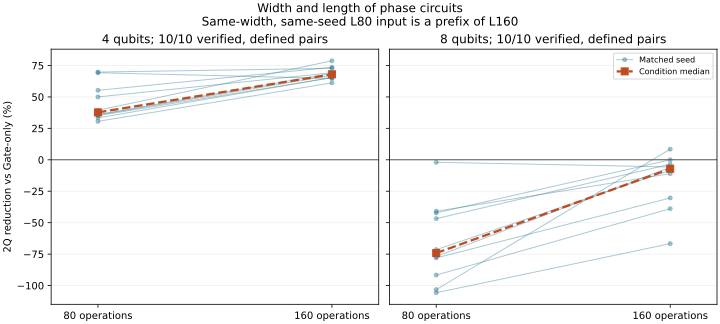
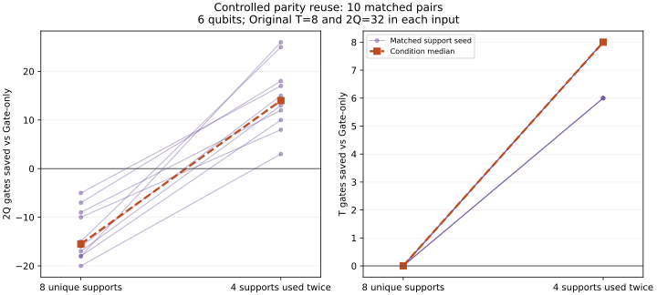
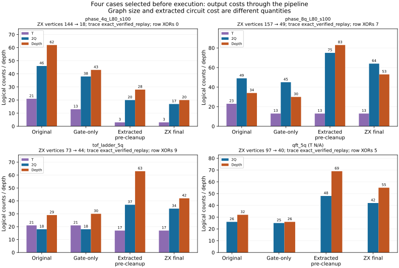

# Stage 2 実行レポート — 幅・長さ・パリティ再利用によるZX最適化の違い

**実行済み。今回の固定パイプラインでは、4量子ビットの位相回路とパリティを再利用する合成回路で、T-countを増やさず2Qゲートを削減できた。一方、8量子ビット・80操作、パリティ再利用なし、QFTでは2Qが増えた。Toffoli ladderではT削減と2Q増加が両立し、目的によって評価が分かれた。** 事前仮説H1〜H5は基準を満たしたが、「連鎖Toffoliの方が追加2Q負担が大きい」というH6は不支持だった。

この結論の対象は、以下の入力と **PyZX 0.10.8、`full_reduce`、元の向きの抽出、固定後処理**である。ZX計算全般や任意の実用回路についての保証ではない。主要な根拠は[全198行の実測値](../runs/stage2-20261124T070501Z/results.csv)、[条件別集計](../analysis/stage2-20261124T070501Z/condition_summary.csv)、[事前仮説の機械可読判定](../analysis/stage2-20261124T070501Z/hypotheses.json)。

## 1. 実行範囲と再現情報

| 項目 | 記録 |
| --- | --- |
| Run ID | `stage2-20261124T070501Z` |
| 実験日時 | 2026-11-24 **16:05:01.931579〜16:05:20.283479 JST** |
| 診断用追跡 | 同日16:05:35 JST、主ベンチマークの時間計測終了後に別実行 |
| 実行前に保存したコードcommit | [`b309dd8f7ec1a8799b0a9a79b1ffee089d71cc97`](https://github.com/Ryoki39-hash/ZX-calculus/commit/b309dd8f7ec1a8799b0a9a79b1ffee089d71cc97) |
| 計画の根拠commit | [`4dbe91ceb5055b9c682d7bfc501879eed34c6925`](https://github.com/Ryoki39-hash/ZX-calculus/blob/4dbe91ceb5055b9c682d7bfc501879eed34c6925/docs/stage2_followup_plan.md) |
| プロトコル | [`stage2-followup-v1`](../runs/stage2-20261124T070501Z/protocol.json)、Stage 1の比較・計測・検証条件を継承 |
| 入力と主比較 | 66入力 × Original / Gate-only / ZX = **198行** |
| A：再現確認 | 位相20、Toffoli ladder 2、QFT 2：**24入力・72行** |
| B：構造比較 | 長さ追加20、パリティ20、Toffoli重なり2：**42入力・126行** |
| C：途中過程 | 事前指定4例を追跡。主比較の入力数には加算しない |

Originalは共通基底へ正規化した入力、Gate-onlyはそこに `basic_optimization` を1回適用したもの、ZXはグラフ簡約・抽出後に同じ後処理を1回適用したもの。**Backward / Reverseは実施していない。** 2QはCNOT＋CZ、depthは固定基底の論理依存層数。実機の配線制約、エラー率、実行時間は測定していない。[メタデータ](../runs/stage2-20261124T070501Z/metadata.json)

以下の削減率はすべて **Gate-onlyを基準**とする。

\[
g_2=100\frac{N_{2Q,Gate}-N_{2Q,ZX}}{N_{2Q,Gate}},\qquad S_2=N_{2Q,Gate}-N_{2Q,ZX}.
\]

正なら削減、負なら増加。「成功」は **T-count非増加かつ2Qの厳密な減少**を意味する。中央値は入力ごとの削減率を集計したもの、角括弧は最小値〜最大値であり、信頼区間ではない。

## 2. 事前仮説H1〜H6の判定

| 仮説 | 事前に定めた判定基準 | 実測 | 判定 |
| --- | --- | --- | --- |
| H1：幅による対照 | 4q/L80：成功≥8/10かつg₂中央値>0。**かつ**8q/L80：2Q増加≥8/10かつ中央値<0 | 4q成功10/10、中央値+37.7%。8q増加10/10、中央値−74.2% | 支持 |
| H2：Toffoli ladder | 5q・7qの両方でT減少かつ2Q増加 | 2/2で成立 | 支持 |
| H3：QFT | 5q・7qの両方で2Q・depth増加 | 2/2で成立 | 支持 |
| H4：8qで長さを増やす | seedごとのg₂(L160)−g₂(L80)>0が≥8/10、差の中央値>0 | 9/10、中央値 **+45.5ポイント**［−3.7, +111.7］ | 支持 |
| H5：パリティ再利用 | S₂(reuse)−S₂(unique)>0が≥8/10、差の中央値>0 | 10/10、中央値 **+26.5ゲート**［18, 44］。reuse成功10/10、T増加0件 | 支持 |
| H6：Toffoli重なり | cascadeの追加2Q負担がdisjointより大きい | cascade +12、disjoint +18、差 **−6** | **不支持** |

各仮説の対象入力はすべて検証済みで、欠測・除外・シード差し替えはない。8/10という閾値は事前に定めた傾向の再現基準であり、統計的有意性を表さない。「不支持」も、一般命題の否定や逆方向の普遍的法則を意味しない。[判定の全数値と分母](../analysis/stage2-20261124T070501Z/hypotheses.json)

## 3. 位相回路：4qでは安定して効き、8qは長くしても大半で2Qが増える

| 条件 | 検証済み | 成功数 | T削減率中央値 | 2Q削減率中央値［最小, 最大］ | depth削減率中央値 | ZX/Gate最適化時間比の中央値 |
| --- | ---: | ---: | ---: | ---: | ---: | ---: |
| 4q・80操作 | 10/10 | **10/10** | 46.2% | **37.7%［30.6, 69.8］** | 35.7% | 6.75倍 |
| 4q・160操作 | 10/10 | **10/10** | 62.8% | **68.0%［61.2, 78.8］** | 68.1% | 7.44倍 |
| 8q・80操作 | 10/10 | **0/10** | 0.0% | **−74.2%［−105.7, −2.0］** | −70.7% | 9.39倍 |
| 8q・160操作 | 10/10 | **1/10** | 7.7% | **−7.1%［−66.7, 8.5］** | −25.5% | 13.07倍 |

長さを増やすと8qの相対的な悪化は9/10組で小さくなった。しかし、160操作でも **2Q減少1件・同数1件・増加8件**である。「長くすると改善方向へ動く」と「Gate-onlyより良くなる」は分けて結論を書く必要がある。唯一の2Q減少例 `stage2_phase_8q_L160_s102` はT **13→11**、2Q **71→65**だが、depthは **50→58**と悪化した。[対応比較CSV](../analysis/stage2-20261124T070501Z/phase_length_pairs.csv)、[全入力の指標](../analysis/stage2-20261124T070501Z/paired_results.csv)

操作数/量子ビット数を20に揃えた **4q・80操作と8q・160操作**でも、2Q削減率中央値は+37.7%と−7.1%で差が残った。したがって「1量子ビット当たりの操作数が少なかっただけ」で幅の差をすべて説明することはできない。一方、同じseedでも異なる幅ではゲート配置が一致しないため、幅だけの因果効果を分離した実験とも言えない。

### 全seedの2Q削減率

| seed | 4q L80 | 4q L160 | 8q L80 | 8q L160 | 8qの対応差：L160−L80 |
| ---: | ---: | ---: | ---: | ---: | ---: |
| 100 | 55.26% | 73.61% | −42.22% | 0.00% | +42.22pt |
| 101 | 69.23% | 64.71% | −46.81% | −3.49% | +43.32pt |
| 102 | 36.00% | 68.75% | −103.23% | +8.45% | +111.68pt |
| 103 | 39.39% | 78.75% | −40.91% | −10.99% | +29.92pt |
| 104 | 33.33% | 65.45% | −91.67% | −38.89% | +52.78pt |
| 105 | 69.77% | 72.73% | −2.00% | −5.68% | **−3.68pt** |
| 106 | 35.14% | 65.38% | −78.05% | −30.34% | +47.71pt |
| 107 | 35.71% | 67.19% | −71.43% | −8.33% | +63.10pt |
| 108 | 50.00% | 69.23% | −105.71% | −66.67% | +39.05pt |
| 109 | 30.56% | 61.19% | −76.92% | −5.95% | +70.97pt |

H4の45.5ポイントは**10個の対応差の中央値**である。二つの条件中央値を引いた値ではない。同じ幅・seedではL80がL160の厳密な先頭部分なので、40入力を完全に独立な40標本として扱わない。



*Figure 1. Inputwise two-qubit gate reductions relative to Gate-only for phase circuits. Lines connect the same seed at a fixed width; the L80 input is a prefix of L160. Dashed lines show condition medians. Positive values indicate reductions. All 40 inputs passed numerical equivalence checks.*

## 4. パリティ再利用：Tと2Qを同時に削減する明確な対照

6量子ビット、8個の位相ガジェット、OriginalのT=8・2Q=32を揃えた。再利用側は4種類の支持集合を2回ずつ、再利用なし側は8種類を1回ずつ使う。**再利用側は10/10でTが0となり、2Qとdepthも減少した。再利用なし側はT=8のまま、10/10で2Qが増加した。** 再利用側の2Q削減率中央値は50.7%［16.7, 81.3］、再利用なし側は−59.6%［−76.9, −17.9］だった。[全ペアCSV](../analysis/stage2-20261124T070501Z/parity_pairs.csv)

| seed | 再利用：2Q Gate→ZX | 再利用なし：2Q Gate→ZX | 再利用の追加利益 S₂差 | 再利用：T Gate→ZX |
| ---: | ---: | ---: | ---: | ---: |
| 100 | 32→19 | 24→41 | +30 | 8→0 |
| 101 | 22→10 | 26→35 | +21 | 8→0 |
| 102 | 24→16 | 24→34 | +18 | 8→0 |
| 103 | 22→12 | 24→42 | +28 | 6→0 |
| 104 | 24→7 | 28→33 | +22 | 6→0 |
| 105 | 32→7 | 26→41 | +40 | 8→0 |
| 106 | 32→17 | 26→42 | +31 | 8→0 |
| 107 | 32→6 | 26→44 | +44 | 8→0 |
| 108 | 28→10 | 30→37 | +25 | 6→0 |
| 109 | 18→15 | 26→46 | +23 | 6→0 |

再利用なし側のTは全seedで8→8。再利用側ではGate-onlyも一部のTや2Qを削減しているため、Originalからの削減をすべてZXの追加利益とは数えていない。

機構としては、同じパリティに付いた+π/4位相を2回まとめると+π/2となり、非CliffordのT相当位相を除ける構造を意図的に入れている。観測されたT=0はこの説明と整合する。ただし、**ペアの二回路は一般に異なるユニタリ**であり、各々を自身のOriginalに対して検証した。これは機構を確認する人工的な対照で、ZX固有の優位性や実用アルゴリズムの平均改善率の証明ではない。

また、入力のdepth・支持頻度は完全には揃っていない。seed105では再利用側の活性ワイヤが5本、再利用なし側が6本だった。他の9組は両側6本である。この交絡を隠さず、今回は事前計画どおり全10組を保持した。[入力構造の全記録](../analysis/stage2-20261124T070501Z/input_structure.json)



*Figure 2. Absolute two-qubit and T-gate savings relative to Gate-only for ten matched support seeds. Original circuits have identical T and two-qubit counts, but the paired circuits generally implement different unitaries. Repeated supports were deliberately introduced as a mechanism test; overlapping lines are retained in the paired CSV.*

## 5. ToffoliとQFT：悪化とトレードオフをそのまま残す

各セルは **T / 2Q / depth**。全18主比較行が検証済み。

| 入力 | Original | Gate-only | ZX | 解釈 |
| --- | ---: | ---: | ---: | --- |
| `stage2_tof_ladder_5q` | 21 / 18 / 29 | 21 / 18 / 30 | **17 / 34 / 42** | T−19.0%、2Q+88.9%、depth+40.0% |
| `stage2_tof_ladder_7q` | 35 / 30 / 47 | 35 / 30 / 48 | **27 / 56 / 72** | T−22.9%、2Q+86.7%、depth+50.0% |
| `stage2_qft_5q` | N/A / 26 / 32 | N/A / 25 / 26 | **N/A / 42 / 55** | 2Q+68.0%、depth+111.5% |
| `stage2_qft_7q` | N/A / 51 / 48 | N/A / 50 / 39 | **N/A / 79 / 68** | 2Q+58.0%、depth+74.4% |
| `stage2_tof6_disjoint2` | 14 / 12 / 11 | 14 / 12 / 12 | **14 / 30 / 20** | T同じ、2Q+18 |
| `stage2_tof6_cascade2` | 14 / 12 / 20 | 14 / 12 / 21 | **12 / 24 / 36** | T−2、2Q+12 |

QFTは一般角を保った正確な回路で、近似Clifford+T合成をしていないためT-countはN/Aである。T=0という意味ではない。Originalの最適化時間も、最適化処理がないためN/Aとする。[全主比較](../analysis/stage2-20261124T070501Z/all_results.md)

H6は予測と逆で、独立なToffoli二つの方が追加2Q負担が6個大きかった。ただし活性ワイヤはdisjoint=6、cascade=4であり、これだけから「重なるほど良い」と結論を反転させてはいけない。cascadeは既存4q ladderに恒等ワイヤを足した診断例で、5q ladderも旧パイロットに存在する。66入力ファイルを、66個の完全に新規・独立なアルゴリズムとは数えない。

## 6. 抽出途中の追跡：グラフが小さくなっても回路コストは増える

結果を見る前に固定した4例で、保存グラフの同一性と抽出直後QASMのハッシュ一致を確認して診断を実行した。**4/4が `exact_verified_replay`**。最終結果の時間計測に診断処理は含めていない。[診断サマリー](../analysis/stage2-20261124T070501Z/diagnostics/summary.md)、[機械可読記録](../analysis/stage2-20261124T070501Z/diagnostics/summary.json)

| 事前指定例 | 簡約前→後の頂点数 | T：Gate→抽出直後→ZX | 2Q：Gate→抽出直後→ZX | depth：Gate→抽出直後→ZX |
| --- | ---: | ---: | ---: | ---: |
| Phase 4q L80 seed100 | 144→18 | 13→3→3 | 38→20→17 | 43→28→20 |
| Phase 8q L80 seed100 | 157→49 | 13→13→13 | 45→75→64 | 30→83→53 |
| Toffoli ladder 5q | 73→44 | 21→17→17 | 18→37→34 | 30→63→42 |
| QFT 5q | 97→40 | N/A | 25→48→42 | 26→69→55 |

すべて頂点数は減ったが、後ろの3例は抽出直後にGate-onlyより2Qが多く、共通後処理後にも超過が残った。したがって「グラフを小さくすれば出力回路も安くなる」という説明は、この実測とは合わない。

抽出直後の2Qを実際の発生箇所に分けると次のようになった。

| 例 | 行列の行XORに伴うCNOT | frontier処理のCZ | 最終ワイヤ順を戻すSWAPのCNOT分解 | 合計2Q |
| --- | ---: | ---: | ---: | ---: |
| Phase 4q | 0 | 11 | 9 | **20** |
| Phase 8q | 7 | 56 | 12 | **75** |
| Toffoli 5q | 9 | 19 | 9 | **37** |
| QFT 5q | 5 | 34 | 9 | **48** |

この4例ではfrontierのCZが抽出直後2Qの最大成分であり、ワイヤ順を維持するためのSWAP分解も無視できない。**「行列消去でCNOTが増えたから」という説明だけでは不十分**だった。表は実際に出力されたゲートの内訳であり、各ゲートが数学的に必要だったことや、別の抽出法でも避けられないことを示すものではない。



*Figure 3. Logical gate counts and dependency depths for four cases selected before execution. Extracted circuits are normalized before common cleanup. Every displayed stage passed numerical verification; diagnostic extraction reproduced the saved output exactly. Graph vertex reduction does not imply a reduction in extracted circuit cost.*

## 7. 等価性・runtime・未検証の範囲

| 検証項目 | 実測結果 |
| --- | --- |
| 独立な入力定義の意味確認 | **66/66 passed** |
| Original / Gate-only / ZX | **198/198 passed**、欠落0、失敗0 |
| 抽出直後も含む出力検証 | **264/264 passed** |
| 時間計測 | 2手法×66入力×10回 = **1,320回、すべてpassed** |
| 計測出力と検証済み出力のハッシュ | **1,320/1,320一致** |
| 主比較出力の最大絶対残差 | **3.82×10⁻¹⁵** |
| 抽出直後を含む最大絶対残差 | **6.64×10⁻¹⁵** |
| 最適化時間 | ZXが **66/66で長い**。入力別ZX/Gate比の中央値 **8.68倍**、範囲4.91〜16.48倍 |

検証は独立なNumPyゲート作用評価器で全計算基底入力を比較し、固定ワイヤ順・絶対値1の大域位相のみを許容した。許容誤差は`atol=1e-9, rtol=0`。これは有限精度の数値的証拠であり、厳密な等価性証明と区別する。検証器の正例・負例コントロールもpassedだった。[検証器コントロール](../runs/stage2-20261124T070501Z/verifier_controls.json)、[監査集計](../analysis/stage2-20261124T070501Z/summary.json)

時間は古典計算による最適化の処理時間であり、量子回路の実行時間ではない。各入力でウォームアップ1回、計測10回、手法順を交互にし、検証・保存・計数を計測から除外した。同じ実行内の比較だが、短いミリ秒単位の処理には実行環境の揺らぎが残る。Stage 1との絶対時間の差をアルゴリズムの進歩とは解釈しない。[時間成分表](../analysis/stage2-20261124T070501Z/runtime_components.csv)

全Clifford+T入力64件中、**T非増加かつ2Q厳密減少は31件**。そのうち30件はdepthも減少し、残る1件は前述の8q/L160/seed102でdepthが増加した。集計の`improvement`は32件だが、これはTだけ減って2Qが同数の `stage2_phase_8q_L160_s100` も含むためである。64件は異質な設計条件を混ぜた数なので、31/64を任意の回路に対する成功確率とはしない。

**今回まだ評価していないもの**は、8量子ビットを超える規模、別の回路生成分布、実機への配置・ルーティング、近似QFTのT合成コスト、別の最適化器との比較である。Stage 1にあったRandom Clifford+TとRepeated Pauli rotationsにも今回の新seed追試はない。単一の「総コスト」は重みを定義していないため算出していない。

## 8. 研究として書ける結論と次の行動

卒論の中心結論は、**「この固定PyZXパイプラインの追加利益は、回路ファミリー名だけでなく幅・長さ・再利用できるパリティ構造に依存し、T削減と2Q/depth削減は一致しない」**とするのが適切である。Stage 1の探索から選んだ両極端を、新seedと事前に定めた対照で追試した点が今回の成果になる。Stage 1も2026-11-24の実行であり、今回の結果を前日の実験と混同しない。[Stage 1の結果](../runs/stage1-20261124T012423Z/results.csv)

次は以下を優先する。いずれも**提案であり、このRunでは未実施**。

1. **本文と図表を固定し、別環境で再現性を確認する。** 主図を幅×長さ、パリティ対照、抽出過程の3枚、主表をH1〜H6とToffoli/QFTに絞る。H6の不支持とdepthの例外も本文に残す。保存したコード・入力から別環境で同じゲート数と等価性が再現されるかを確認し、runtimeは環境ごとに区別する。
2. **ZX固有の利益まで主張したい場合は比較対象を追加する。** パリティ再利用は合成入力の既知の冗長性なので、位相多項式やパリティ構造を利用するZX以外の手法と比較しない限り、今回の `basic_optimization` を使うGate-onlyに対する追加利益に主張を限定する。追加時は新プロトコルとして基底・後処理・時間範囲を固定する。
3. **H6を再検討する場合は対照そのものを再設計する。** 宣言上は既に両方6qであり、恒等ワイヤを足しても活性ワイヤ6対4の交絡は消えない。2個の独立CCXは6本を使う一方、共有すれば活性ワイヤ数が減る。活性数を揃えるなら複数CCXを使う別の回路族を設計するか、今回の結論を2例の観測に限定する。都合のよい例だけを追加しない。
4. **抽出を改善する研究へ進める場合は追加負担を次の仮説にする。** 4例で観測したfrontier CZ・ワイヤ順補正を手掛かりに、条件を事前固定した追加解析を設計する。4例の内訳から全入力の原因を一般化しない。元の向きの抽出を維持し、Backwardは追加しない。

2〜4は主張の範囲を広げる場合の選択肢であり、今回のStage 2完了や卒論の基本結論を成立させるために、無期限の実験追加を必要とするものではない。

## 9. English thesis draft and progress table

> Under a fixed forward-only PyZX 0.10.8 pipeline, we evaluated 66 input circuits using Original, Gate-only, and ZX conditions. All 198 primary outputs passed independent numerical equivalence checks. For phase circuits, every four-qubit input reduced the two-qubit gate count without increasing the T-count at both 80 and 160 operations (10/10 per condition). All eight-qubit inputs at 80 operations increased the two-qubit count. Increasing their length to 160 operations improved the reduction rate in nine of ten matched seeds, but the median reduction remained negative (−7.1%). Controlled parity reuse yielded strict two-qubit reductions without T-count increases in all ten inputs, whereas all ten unique-support controls increased the two-qubit count. Toffoli ladders exhibited a T-versus-two-qubit trade-off, and both QFT inputs increased two-qubit count and depth. The predeclared prediction that cascaded Toffoli gates would incur a larger additional two-qubit burden than disjoint gates was not supported. Traces of four preselected circuits showed that graph simplification can coexist with increased extracted circuit costs, with frontier CZ gates and fixed-wire permutation correction contributing substantial costs. These findings characterize the evaluated pipeline and synthetic circuit distributions; they do not establish a universal advantage or limitation of ZX-calculus optimization. Classical optimization time was higher for ZX in every input, with a median within-input time ratio of 8.68.

| Work package | Status | Evidence | Interpretation |
| --- | --- | --- | --- |
| Frozen protocol and generators | Completed before execution | Source commit `b309dd8f7ec1a8799b0a9a79b1ffee089d71cc97` | Rules, seeds, and diagnostic cases were not selected from Stage 2 outcomes |
| Replication batch A | Completed: 24 inputs / 72 rows | H1–H3 supported under the predeclared criteria | Extends the earlier exploratory contrasts within the fixed protocol |
| Controlled batches B1–B3 | Completed: 42 inputs / 126 rows | H4–H5 supported; H6 not supported | Relative length effects, engineered parity reuse, and a failed overlap prediction |
| Diagnostic replay C | Completed: 4/4 exact verified replays | Saved graph and extracted-output hashes reproduced | Observed gate attribution, not a lower bound or optimality proof |
| Equivalence and timing audit | Completed | 198 primary + 66 intermediate checks; 1,320 timed-output hash matches | Numerical evidence with fixed wire order and unit global phase |
| Independent-environment reproduction | Proposed; not executed | Frozen source and archived inputs | Prioritized alongside thesis writing; timing remains environment-specific |
| Additional baselines and active-wire controls | Optional proposals; not executed | Section 8 | Needed only to extend causal and optimizer-specific claims |

## 10. データと再生成

- [全198行＋全seedを読める表](../analysis/stage2-20261124T070501Z/all_results.md)
- [Original / Gate-only / ZXを横に並べたCSV](../analysis/stage2-20261124T070501Z/paired_results.csv)
- [H1〜H6の全判定](../analysis/stage2-20261124T070501Z/hypotheses.json)
- [入力・グラフ・出力・timing・verificationの保存アーカイブ](../runs/stage2-20261124T070501Z/artifacts.zip)
- [アーカイブ内各ファイルのSHA-256索引](../runs/stage2-20261124T070501Z/artifact_index.json)
- [固定4例の全イベントJSONアーカイブ](../analysis/stage2-20261124T070501Z/diagnostics/traces.zip)（[内容と取り出し方](../analysis/stage2-20261124T070501Z/diagnostics/README.md)、[ハッシュ索引](../analysis/stage2-20261124T070501Z/diagnostics/trace_index.json)）
- [独立したCSV再計算・ハッシュ監査](../analysis/stage2-20261124T070501Z/independent_audit.json)
- [再生成スクリプト](../analysis/summarize_stage2.py)

アーカイブのメンバー名はrunディレクトリからの相対パスである。例えば入力定義は `inputs/stage2_phase_8q_L160_s102.json`、全出力検証は `verification.json`、全計測反復は `timings.json`。GitHub上ではアーカイブをダウンロードして参照する。分析スクリプトは展開済みファイルがなければ同アーカイブから読み、最適化を再実行せず表・判定・図を再生成する。

```bash
python analysis/summarize_stage2.py stage2-20261124T070501Z
```

実行前に保存した分析スクリプトのSHA-256は `7df72725ebcc5b229ee84931ff1d8d20270a95103f829e6ffd0febf4d2c8436a`。全結果CSVのSHA-256は `ab26395723f28a525a63bdb97858ce1cac5376ac65be48add679c539e56af6c5`。このレポートの数値はそのCSVと保存JSONを分析したもので、サイトのデモ値は使用していない。
